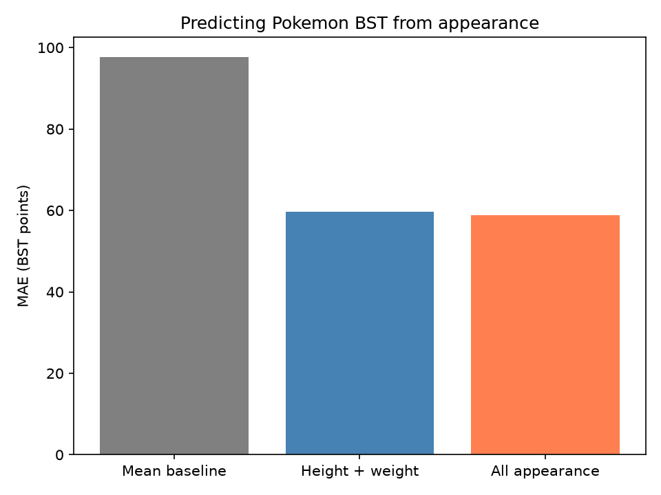

# 포켓몬 외형으로 종족값 총합 예측하기 — 실험 결과

**외형 정보를 사용하면 평균값만 예측할 때보다 오차가 줄었다. 키·몸무게가 예측에 도움이 되었으며, 색상·몸 형태를 추가한 효과는 작았다.**

## 1. 프로젝트 목적

포켓몬의 키·몸무게·색상·몸 형태를 보고 종족값 총합(BST)을 예측할 수 있는지 확인한다.

BST는 **HP + 공격 + 방어 + 특수공격 + 특수방어 + 스피드**의 합이다. 숫자를 예측하는 문제이므로 회귀 모델을 사용한다. BST는 기본 능력치의 합이며, 실제 대전 승률을 뜻하지 않는다.

## 2. 데이터와 실험 방법

- 데이터 출처: PokéAPI에서 수집한 [data/pokemon.csv](data/pokemon.csv)
- 데이터 수: 포켓몬 1,025종, 종마다 기본 형태 1개
- 입력: 키(cm), 몸무게(kg), 색상, 몸 형태
- 정답: BST. 이름과 BST는 입력에서 제외
- 데이터 상태: 결측값 0개, 중복 행 0개
- 학습·평가 분리: 학습 820종(80%), 평가 205종(20%), `random_state=42`

평균값만 예측하는 기준선과 랜덤 포레스트 회귀 모델을 비교했다. 두 외형 모델은 같은 학습·평가 데이터와 같은 설정(`n_estimators=100`, `max_depth=5`, `random_state=42`)을 사용했다. 색상·몸 형태는 `pd.get_dummies`로 0과 1의 열로 변환했다.

평가 지표는 **MAE(평균 절대 오차)**다. 실제값과 예측값의 차이를 절댓값으로 계산한 뒤 평균 낸 값이며, 낮을수록 좋다.

## 3. 모델별 결과

현재 [results.csv](results.csv)에 저장된 결과다.

| 모델 | 입력 정보 | MAE(BST 점수) |
|---|---|---:|
| 평균값 기준선 | 외형 없이 학습 데이터의 평균 BST만 예측 | 97.60 |
| 랜덤 포레스트 | 키·몸무게 | 59.62 |
| 랜덤 포레스트 | 키·몸무게·색상·몸 형태 | **58.84** |

### 결과 해석

**외형 정보는 BST 예측에 도움이 되었다.** 전체 외형 모델은 평균값 기준선보다 오차가 약 38.76점, 비율로는 **39.7%** 줄었다. 키·몸무게만 사용해도 오차가 크게 줄어, 이번 실험에서는 두 특성만으로도 유용한 예측 정보를 얻었다.

**색상·몸 형태의 추가 효과는 작았다.** 키·몸무게 모델과 비교하면 오차가 약 **0.78점** 줄었다. 한 번의 평가 결과이므로 이 작은 차이가 다른 데이터 분할에서도 유지된다고 단정할 수는 없다.

MAE 58.84는 평가 포켓몬에서 실제 BST와 예측값의 차이가 평균적으로 약 59점이었다는 뜻이다. 모든 포켓몬이 ±59점 안에 들어간다는 의미는 아니다.

## 4. BST 분포를 고려한 성능

아래 통계는 학습·평가 데이터를 합친 전체 1,025종을 기준으로 계산했다.

| 통계 | BST |
|---|---:|
| 평균 | 427.69 |
| 표준편차(표본) | 112.77 |
| 최솟값 | 175 |
| 25% 지점 | 325 |
| 중앙값 | 450 |
| 75% 지점 | 508 |
| 최댓값 | 720 |

MAE 58.84는 전체 평균 BST의 약 **13.8%**에 해당한다. 전체 BST의 차이가 크고 평균값 기준선보다 오차가 확실히 줄었다는 점에서, **입문 프로젝트로는 의미 있는 결과이며 대략적인 BST 예측에 활용할 수 있다.** 다만 수십 점 차이의 포켓몬을 정확히 구분하거나 순위를 매기기에는 오차가 크다.

이 13.8%는 오차의 규모를 설명하는 참고 수치다. 이를 빼서 “정확도 86.2%”라고 표현하면 안 된다.

## 5. 한계와 결론

이번 결과는 고정된 무작위 분할 한 번에서 얻었다. 같은 진화 계열의 포켓몬이 학습·평가 양쪽에 포함될 수 있어, 처음 보는 진화 계열에서도 같은 성능을 낸다고 단정할 수 없다. 또한 외형을 이용한 예측 결과이지, 외형이 능력치를 결정한다는 인과관계의 증거는 아니다.

**이번 실험에서는 외형 정보로 BST를 어느 정도 예측할 수 있었고, 색상·몸 형태를 추가하는 것보다 키·몸무게를 사용하는 단계에서 큰 개선이 나타났다.** 데이터 수집, 전처리, 회귀 모델 학습, 기준선 비교까지 수행한 간단한 머신러닝 프로젝트로 정리할 수 있다.

결과를 다시 생성하려면 `02_train.py`를 실행한다. 이 문서는 현재 결과를 정리한 파일이므로, 향후 데이터나 모델을 바꾸면 수치도 함께 갱신해야 한다.
